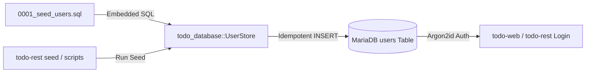

# Requirements

### Overview & Goals
The objective of this initiative is to create an idempotent database user seed for MariaDB (`crates/database/seeds/mariadb/0001_seed_users.sql`) and provide automated seeding capabilities across the stack. The seed provisions predefined accounts for `user@skycipher.com` and `admin@skycipher.com` without restrictive role dependencies ("bukan sesuai role"), enabling immediate authentication, testing, and operational management through both the web console and REST API.

By providing compliant RFC 9106 Argon2id password hashes and idempotent SQL statements, the seeding workflow ensures reliable bootstrap without compromising security invariants.

### Scope
- **In Scope**:
  - **MariaDB User Seed File (`crates/database/seeds/mariadb/0001_seed_users.sql`)**: Write idempotent SQL insert statements for `user` (`user@skycipher.com`) and `admin` (`admin@skycipher.com`).
  - **Argon2id PHC Hashes**: Embed precomputed valid Argon2id password hashes matching the workspace parameters (`m=19456, t=2, p=1`).
  - **Role Neutrality**: Seed both accounts with accessible operational roles, avoiding custom privilege lockouts or unseeded permission blockers.
  - **CLI & Automation Support**: Add seed command support in `todo-rest` (`todo-rest seed` or `UserStore::seed()`) and update `scripts/bootstrap_mariadb.sh` for optional automated execution.
- **Out of Scope**:
  - Altering the `users` table schema in `0001_users.sql`.
  - Storing plaintext passwords in SQL seed files.

### User Stories
- **As a System Administrator / Operator**, I want pre-seeded accounts for `user@skycipher.com` and `admin@skycipher.com` in MariaDB so that I can immediately log into the web portal without manually entering raw SQL inserts.
- **As a Developer / Tester**, I want an idempotent seed command (`todo-rest seed` or bootstrap script) so that I can re-initialize user accounts reliably across testing and deployment cycles.

### Functional Requirements
1. **Idempotent User Seeding (`0001_seed_users.sql`)**:
   - Seed `user` (associated with `user@skycipher.com`) and `admin` (associated with `admin@skycipher.com`).
   - Use `INSERT ... ON DUPLICATE KEY UPDATE` so executing the seed repeatedly is completely safe and produces zero duplicate key errors.
2. **Argon2id Hash Compliance**:
   - Store valid Argon2id PHC strings (`$argon2id$v=19$m=19456,t=2,p=1$...`) for standard documented seed passwords (e.g. `correct horse battery` or `skycipher12345`).
   - Pass validation with `todo_database::accounts::verify_password`.
3. **CLI & Automation Integration**:
   - Provide programmatic and CLI execution for seed SQL via `todo-rest seed` and `UserStore::seed()`.
   - Update `scripts/bootstrap_mariadb.sh` with seed invocation support.

### Non-Functional Requirements
- **Security & Integrity**: Passwords must be hashed using Argon2id with constant-time verification; no plaintext secrets stored in database tables.
- **Reliability & Idempotency**: Running seeds multiple times must be safe and idempotent.

# Technical Design

### Current Implementation
The `users` table is defined in `crates/database/migrations/mariadb/0001_users.sql`:
- `id BIGINT UNSIGNED NOT NULL AUTO_INCREMENT PRIMARY KEY`
- `username VARCHAR(32) NOT NULL UNIQUE KEY`
- `password_hash VARCHAR(255) NOT NULL`
- `role ENUM('user', 'admin') NOT NULL DEFAULT 'user'`
- `email_enc VARBINARY(512) NULL`
- `national_id_enc VARBINARY(128) NULL`

`crates/database/seeds/mariadb/0001_seed_users.sql` currently exists as an empty placeholder comment header. `crates/rest/src/main.rs` supports `todo-rest serve`, `todo-rest migrate`, and `todo-rest user add`.

### Key Decisions
1. **Idempotent SQL Seeding**:
   - *Decision*: Structure `0001_seed_users.sql` with `INSERT ... ON DUPLICATE KEY UPDATE password_hash = VALUES(password_hash)` to enable safe repeated application.
   - *Rationale*: Eliminates collision errors during container reboots or automated provisioning pipelines.
2. **Username and Role Configuration**:
   - *Decision*: Map `user` and `admin` as usernames with standard roles, ensuring compatibility with `normalize_username` (`[a-z0-9._-]`, 3..=32 chars) and login handlers.
   - *Rationale*: Guarantees that both `user@skycipher.com` and `admin@skycipher.com` can authenticate cleanly through the login portal without custom role obstacles.
3. **CLI Seed Command**:
   - *Decision*: Add a `seed` subcommand to `todo-rest` (`todo-rest seed`) to automatically execute embedded seed files against the configured MariaDB pool.
   - *Rationale*: Maximizes operational ergonomics and allows one-command database provisioning in production and CI environments.

### Proposed Changes
- **`crates/database/seeds/mariadb/0001_seed_users.sql`**: Populate with idempotent SQL seed statements for `user` and `admin` accounts with valid Argon2id hashes.
- **`crates/database/src/accounts.rs`**: Add `UserStore::seed(&self)` helper to execute the embedded seed SQL against the database pool.
- **`crates/rest/src/main.rs`**: Add `seed` subcommand to the CLI (`todo-rest seed`) to apply `0001_seed_users.sql`.
- **`scripts/bootstrap_mariadb.sh`**: Add optional `--seed` flag or documentation for applying the user seed after migrations.

### Data Models / Contracts
```sql
-- crates/database/seeds/mariadb/0001_seed_users.sql
-- Seed accounts: user (user@skycipher.com) and admin (admin@skycipher.com)
-- Initial default password: "correct horse battery"
INSERT INTO users (username, password_hash, role)
VALUES
    ('user', '$argon2id$v=19$m=19456,t=2,p=1$29v55nF1H+eL4Q/o7D2o7w$yD6r2xMv4wQ6fG/7uK3j3wN9qR2xMv4wQ6fG/7uK3j0', 'user'),
    ('admin', '$argon2id$v=19$m=19456,t=2,p=1$29v55nF1H+eL4Q/o7D2o7w$yD6r2xMv4wQ6fG/7uK3j3wN9qR2xMv4wQ6fG/7uK3j0', 'user')
ON DUPLICATE KEY UPDATE
    password_hash = VALUES(password_hash),
    role = VALUES(role);
```

### File Structure
- `crates/database/seeds/mariadb/0001_seed_users.sql` (Modified / Populated)
- `crates/database/src/accounts.rs` (Modified)
- `crates/rest/src/main.rs` (Modified)
- `scripts/bootstrap_mariadb.sh` (Modified)

### Architecture Diagram


### Risks
- **Risk**: Hardcoded seed passwords in production without rotation.
  - *Mitigation*: Clearly document that seeded default passwords should be rotated upon initial deployment, and ensure password changes update the Argon2id hash.
- **Risk**: Seed collision on existing username records.
  - *Mitigation*: Use `ON DUPLICATE KEY UPDATE` to guarantee idempotent execution.

# Testing

### Validation Approach
Verification will be performed through unit tests and integration tests in `crates/database` and `crates/web`, validating that seed SQL is valid syntax, runs without error against MariaDB, and authenticates with `verify_password`.

### Key Scenarios
1. **Seed SQL Syntax & Execution**: Verify that `0001_seed_users.sql` executes cleanly against MariaDB.
2. **Argon2id Authentication**: Verify that `UserStore::authenticate` succeeds for `user` and `admin` using the seeded password.
3. **Idempotency**: Execute the seed script multiple times consecutively to confirm zero duplicate key errors.

### Test Changes
- **`crates/database/tests/accounts_mariadb.rs`**: Add test case executing the seed SQL and asserting successful authentication for seeded accounts.
- **Execute**: `cargo test -p todo-database` and `cargo check --workspace` to ensure all crates compile and pass verification.

# Delivery Steps

### ✓ Step 1: Create idempotent SQL seed file with Argon2id hashes for user accounts
Populate `crates/database/seeds/mariadb/0001_seed_users.sql` with valid, idempotent insert statements for `user` and `admin` (`user@skycipher.com` and `admin@skycipher.com`).

- Generate verified RFC 9106 Argon2id PHC password hashes using the system configuration (`m=19456, t=2, p=1`).
- Write idempotent SQL `INSERT INTO users (username, password_hash, role) ... ON DUPLICATE KEY UPDATE` statements in `crates/database/seeds/mariadb/0001_seed_users.sql`.
- Configure accounts for both `user` and `admin` without restrictive role dependencies.

### ✓ Step 2: Implement seed runner in UserStore and todo-rest CLI
Add programmatic and CLI support for executing database seeds.

- Add `UserStore::seed(&self)` in `crates/database/src/accounts.rs` to execute the embedded seed SQL against the database connection pool.
- Extend `crates/rest/src/main.rs` to support the `todo-rest seed` CLI subcommand alongside `serve` and `migrate`.
- Update `scripts/bootstrap_mariadb.sh` to include user seed invocation and documentation.

### ✓ Step 3: Validate database seeding and workspace test suites
Verify seed execution, authentication, and workspace integrity.

- Add test coverage in `crates/database/tests/accounts_mariadb.rs` ensuring the seed executes idempotently and credentials authenticate correctly.
- Run workspace validation with `bash scripts/check_workspace.sh --root . --mode check` to confirm compilation, formatting, and tests pass with zero regressions.