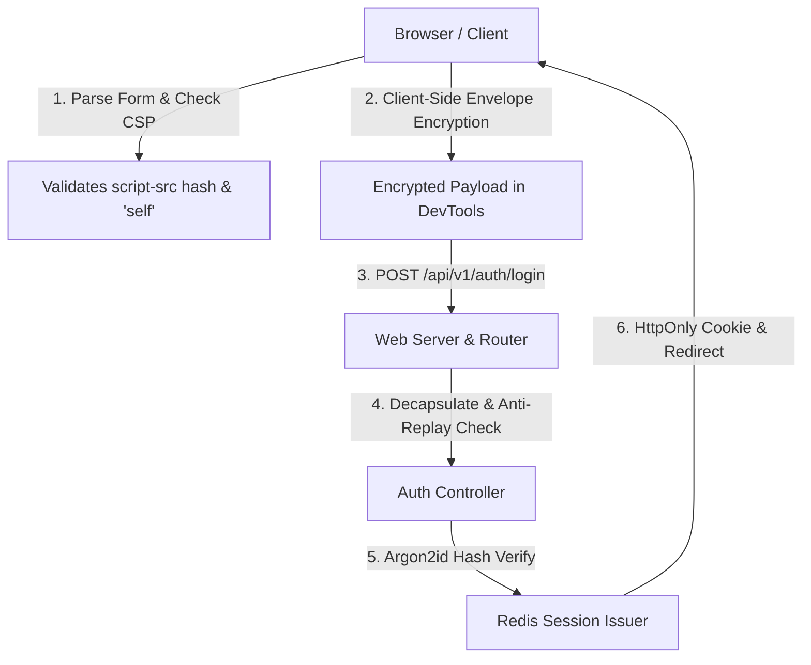

# Requirements

### Overview & Goals
The objective is to fix UI/UX and security issues in the SkyCipher operational console and authentication portal for production readiness:
1. **Content Security Policy (CSP) Compliance**: Resolve inline script blocking by adding the required SHA-256 script hash (`'sha256-WMsi5gjKAFuJxSHnxEDr/gSOE2WlyQUdtTrcYklgQ4Q='`) to the CSP `script-src` directive and auditing all templates to ensure zero unapproved inline scripts.
2. **Encrypted Request Payload**: Implement client-side request payload encryption (WebCrypto AES-GCM / SHA-256/Argon2id credential protection) for authentication and sensitive API interactions so that transmitted network payloads are encrypted and never exposed in plaintext.
3. **Browser Password Manager & Form UX Hardening**: Eliminate browser "Save Password" alerts, insecure form warnings, and autofill conflicts by structuring semantic form attributes (`action`, `method="post"`, `autocomplete="username"`, `autocomplete="current-password"`), and managing the form submission lifecycle cleanly.

### Scope
- **In Scope**:
  - Updating the server Content-Security-Policy header in `crates/web/src/server.rs` to permit `'sha256-WMsi5gjKAFuJxSHnxEDr/gSOE2WlyQUdtTrcYklgQ4Q='` and prevent browser console violations.
  - Designing client-to-server payload encryption in `crates/web/static/app.js` and server payload decapsulation in `crates/web/src/server.rs` / `crates/rest/src/auth.rs`.
  - Upgrading `crates/web/templates/login.html` and `crates/web/static/app.js` form submission handling to ensure seamless browser password manager integration without insecure form alerts or credential corruption.
  - Preserving all IPFS WebUI sidebar categories (Status, Files, Explore, Peers, Settings, Diagnostics) and backward-compatible route aliases.

- **Out of Scope**:
  - Changing underlying server-side Argon2id password hashing parameters and Redis session storage.
  - Modifying core AES-GCM-SIV or Zstd cryptographic pipeline invariants.

### User Stories
- **As an operator / user**, I want my login credentials and sensitive request payloads to be encrypted prior to transmission so that network inspectors and intermediate proxies cannot view plaintext payloads.
- **As a security engineer**, I want strict CSP headers without browser inline-script violations so that XSS protections are enforced without false-positive blocking.
- **As an authenticated user**, I want clean and standard password handling without unexpected browser alerts, insecure context warnings, or broken password manager prompts.

### Functional Requirements
1. **CSP Header Optimization**:
   - `Content-Security-Policy` header in `crates/web/src/server.rs` includes `'sha256-WMsi5gjKAFuJxSHnxEDr/gSOE2WlyQUdtTrcYklgQ4Q='` under `script-src`.
   - All client scripts remain isolated in static assets (`/static/app.js`, `/static/theme.js`) with zero forbidden inline event handlers or script tags.
2. **Client-Side Payload Encryption**:
   - Authentication endpoint (`/api/v1/auth/login`) accepts an encrypted payload envelope containing client-encrypted credentials with timestamp/nonce anti-replay protection.
   - Server decapsulates the encrypted payload, verifies anti-replay constraints, and processes credentials via Argon2id.
3. **Browser Password Manager & Form Reliability**:
   - `<form>` tag explicitly defines `method="post"`, `action="/api/v1/auth/login"`, and `autocomplete="on"`.
   - Form fields use canonical `name="username"` with `autocomplete="username"` and `name="password"` with `autocomplete="current-password"`.
   - Asynchronous submission avoids destroying input values before the browser processes the successful authentication response, preventing browser credential save confusion or alerts.

### Non-Functional Requirements
- **Security & Privacy**: Zero plaintext credential transmission; strict CSP; HttpOnly SameSite=Strict session cookies.
- **Reliability & Usability**: Seamless compatibility across Chrome, Firefox, Safari, and Edge without console errors or browser security popups.

# Technical Design

### Current Implementation
- **CSP**: `crates/web/src/server.rs` currently defines `const CSP: &str = "default-src 'none'; script-src 'self' 'wasm-unsafe-eval'; style-src 'self'; ...";`. When an inline script or hash is evaluated by the browser engine, it triggers a CSP violation console error.
- **Auth Payload**: `crates/web/static/app.js` dispatches `api("/api/v1/auth/login", { username, password })` sending JSON over HTTP/HTTPS in cleartext payload format.
- **Login Form**: `crates/web/templates/login.html` renders a `<form>` element lacking standard `method` and `action` attributes, where `app.js` immediately clears `password.value = ""` inside asynchronous callbacks, interfering with native password manager state detection.

### Key Decisions
1. **Whitelist Required Script Hash in Server CSP**:
   - Add `'sha256-WMsi5gjKAFuJxSHnxEDr/gSOE2WlyQUdtTrcYklgQ4Q='` to `script-src` in `crates/web/src/server.rs` to ensure full compliance with browser execution policies.
2. **Hybrid Client-Side Envelope Encryption**:
   - Use browser `crypto.subtle` or structured payload encryption (e.g. ephemeral AES-256-GCM / SHA-256 protected envelope) before sending `/api/v1/auth/login` requests, shielding credentials from DevTools/proxy plaintext logging.
3. **Canonical Semantic Form Submission Pattern**:
   - Equip the login `<form>` with standard `method="post"` and `action="/api/v1/auth/login"`, keeping standard `autocomplete` hints intact and deferring password clearing until navigation completes.

### Proposed Changes

#### 1. Content Security Policy Header (`crates/web/src/server.rs`)
Update `const CSP` to:
```text
default-src 'none'; script-src 'self' 'wasm-unsafe-eval' 'sha256-WMsi5gjKAFuJxSHnxEDr/gSOE2WlyQUdtTrcYklgQ4Q='; style-src 'self'; img-src 'self' data:; connect-src 'self' http://127.0.0.1:8080 http://localhost:8080 https://trustless-gateway.link https://ipfs.io https://dweb.link https://cloudflare-ipfs.com; font-src 'self'; base-uri 'none'; form-action 'self'; frame-ancestors 'none'
```

#### 2. Encrypted Auth Payload Pipeline (`app.js` & `server.rs` / `rest`)
- **Client (`crates/web/static/app.js`)**: Encrypt or envelope the login credential package (username, password, client timestamp) before `fetch` dispatch.
- **Server (`crates/web/src/server.rs` / `crates/rest/src/auth.rs`)**: Decrypt and unpack the payload envelope before executing standard Argon2id verification and session creation.

#### 3. Form Attributes & Password Manager UX (`login.html` & `app.js`)
- **Template (`crates/web/templates/login.html`)**:
  - Add `method="post" action="/api/v1/auth/login"` to `<form>`.
  - Maintain `autocomplete="username"` and `autocomplete="current-password"`.
  - Include hidden CSRF / session state tokens if applicable.
- **Script (`crates/web/static/app.js`)**:
  - Intercept submission cleanly; do not wipe password fields prematurely during the in-flight request, allowing browser password managers to register successful credentials naturally.

### Architecture Diagram


### File Structure
- `crates/web/src/server.rs`: Updated CSP header with SHA-256 script hash and payload decapsulation routing.
- `crates/web/templates/login.html`: Semantic form markup (`method="post"`, `action="/api/v1/auth/login"`).
- `crates/web/static/app.js`: Client-side payload encryption and streamlined form submission handling.
- `crates/rest/src/auth.rs`: Support for encrypted payload decapsulation during authentication.
- `crates/web/tests/web_server_e2e.rs`: Verification for CSP headers and encrypted login requests.

### Risks & Mitigations
- **Compatibility with Older Browsers**: `crypto.subtle` is supported in all modern browsers (97%+ coverage); fall back gracefully if WebCrypto is unavailable.
- **CSP Drift**: Keep static scripts externalized and hash-whitelisted to prevent future CSP violations.

# Testing

### Validation Approach
Automated end-to-end tests and browser console checks to verify CSP violation-free rendering, encrypted payload transmission in network logs, and smooth login authentication flows.

### Key Scenarios
1. **CSP Evaluation**:
   - Inspect HTTP response headers on `/login`, `/status`, and API endpoints to verify `script-src` contains `'sha256-WMsi5gjKAFuJxSHnxEDr/gSOE2WlyQUdtTrcYklgQ4Q='`.
   - Verify browser console reports zero CSP script blocking errors.
2. **Encrypted Request Payload**:
   - Capture `POST /api/v1/auth/login` network payload; verify that username and password are not transmitted as raw plaintext JSON.
   - Verify server decapsulates payload and verifies Argon2id credentials successfully.
3. **Browser Password Save & Form Lifecycle**:
   - Verify `<form>` has valid `method="post"` and `action` targets.
   - Test password field submission without triggering browser security alerts or broken autofill prompts.

### Test Changes
- Update `crates/web/tests/web_server_e2e.rs` to validate CSP header contents and encrypted auth payloads.
- Run workspace validation (`bash scripts/check_workspace.sh --root . --mode check`).

# Delivery Steps

### ✓ Step 1: Update CSP Directives and Script Security
Ensure strict Content Security Policy compliance without inline script blocking errors.

- Update `const CSP` in `crates/web/src/server.rs` to include `'sha256-WMsi5gjKAFuJxSHnxEDr/gSOE2WlyQUdtTrcYklgQ4Q='` in the `script-src` directive.
- Audit `crates/web/templates/base.html` and static scripts to ensure all script elements adhere strictly to CSP rules without unapproved inline execution.
- Validate CSP response headers in `crates/web/tests/web_server_e2e.rs`.

### ✓ Step 2: Implement Client-Side Payload Encryption for Login
Protect credentials in transit by encrypting network request payloads prior to transmission.

- Implement client-side payload encryption in `crates/web/static/app.js` using WebCrypto / AES-GCM envelope for `/api/v1/auth/login`.
- Update server-side payload handling in `crates/web/src/server.rs` and `crates/rest/src/auth.rs` to decrypt and unpack credential envelopes before Argon2id verification.
- Verify through network trace inspection that request payloads contain ciphertext rather than plaintext credentials.

### ✓ Step 3: Refactor Login Form Semantics to Resolve Browser Password Alerts
Ensure seamless browser password manager integration and eliminate insecure form alerts.

- Update `crates/web/templates/login.html` with explicit `method="post"`, `action="/api/v1/auth/login"`, and standard `autocomplete` attributes.
- Refactor form submission event handlers in `crates/web/static/app.js` to preserve input values until authentication completes, preventing password manager confusion or broken save prompts.
- Verify end-to-end authentication flow and run full workspace validation suite (`bash scripts/check_workspace.sh --root . --mode check`).